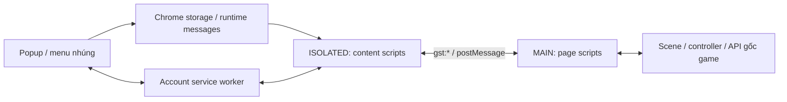
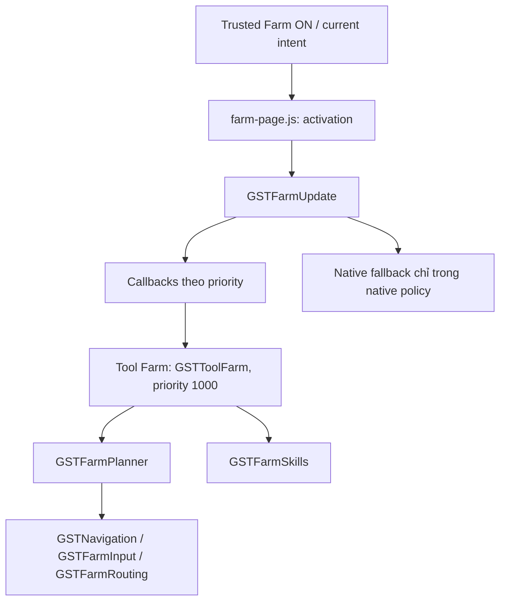

# CodeGraph — Game Speed Tester

> Bản đồ tra cứu source extension hiện hành. Đối chiếu các entry point, manifest, popup và những implementation liên quan tại commit [`e8efee2`](https://github.com/Vibe-Milk/game-speed-tester/commit/e8efee261066fc55d9839d9e5746f79dca814e48). Không phải QA gameplay hay đặc tả game live. Đọc đúng file và call site trước khi sửa.

## 1. Quy trình tra cứu

1. Đọc [AGENTS.md](AGENTS.md) và [ROADMAP.md](ROADMAP.md).
2. Tìm tính năng ở bảng định tuyến dưới đây, mở source liên quan; kiểm tra load order thật trong `manifest.json` và `popup.html`.
3. Nếu liên quan API gốc game, dùng [Wiki v2.0](GAME_ASSET_WIKI_v2.0/README.md) → [FEATURE_INDEX.md](GAME_ASSET_WIKI_v2.0/FEATURE_INDEX.md) → ASSET_INDEX.json / FUNCTION_MAP.md / DEPENDENCY_MAP.md; xác minh source tương ứng và SOURCE_MANIFEST.json.
4. Chỉ mở các đoạn source cần thiết; không đọc toàn bộ bundle mặc định. Không coi tài liệu, trạng thái client hoặc snapshot lưu trữ là bằng chứng runtime.

## 2. Entry point và ranh giới

| Entry / thư mục | Trách nhiệm |
| --- | --- |
| `manifest.json` | Manifest V3, quyền storage, host giới hạn, thứ tự MAIN/ISOLATED, service worker |
| `popup.html`, `ui/popup/popup.js` | Giao diện, cài đặt, điều khiển theo tab, đọc status |
| `core/content.js`, `core/page.js` | Cầu nối cài đặt, timer, overlay trạng thái, tốc độ |
| `features/` | Controller theo tính năng |
| `shared/` | Tài khoản, điều phối, navigation và diagnostics dùng chung |
| `ui/` | Menu, giao diện, layout, search và các presenter |

- Popup nạp script theo thứ tự khai báo trong HTML, không theo danh sách content script.
- MAIN: `harvest-main-options.js` tạo helper Harvest; diagnostics schema, intent authority, dispatcher và navigation được nạp trước các consumer tương ứng. Farm policy/compatibility MAIN được nạp trước các controller; `farm-planner.js` và `farm-skills.js` trước `farm-tool.js`, sau đó `farm-page.js`.
- ISOLATED: account profiles/content trước intent authority; `harvest-options.js` trước `harvest-content.js`; `farm-policy.js` trước `farm-content.js`. Kiểm tra manifest khi đổi thứ tự.
- Service worker của extension: `shared/accounts/account-background.js`. Không nhầm với Worker nhịp mạng hoặc Worker headless của game.

## 3. Bảng định tuyến theo tính năng

Các đường dẫn dưới đây tương đối từ root; tên file rút gọn nằm trong thư mục ở cột thứ hai. File tồn tại hoặc được nạp **không** tự chứng minh controller hoạt động.

| Tính năng | Thư mục | Entry / file nên đọc |
| --- | --- | --- |
| Auto Farm và bật/tắt | `features/automation/auto-farm/` | farm-policy.js, farm-policy-main.js, farm-page.js, farm-content.js, farm-tool.js, farm-session.js, farm-session-popup.js |
| Mục tiêu, đường đi, kỹ năng | `features/automation/auto-farm/` | farm-planner.js, farm-skills.js, farm-monster-classification.js, farm-skill-diagnostics.js, farm-compatibility.js, farm-compatibility-main.js |
| An toàn, hồi phục và tiện ích Farm | `features/automation/auto-farm/` | farm-boss-safety.js, farm-defense.js, farm-encounter.js, farm-visual.js; kiểm tra gate ở farm-page.js |
| Farm cũ / tương thích | `features/automation/auto-farm/` | farm-custom.js, farm-map.js, farm-behavior.js, farm-combat.js, farm-seals.js, farm-party.js; không coi là controller Tool hiện hành |
| Harvest | `features/automation/auto-harvest/` | harvest-options.js, harvest-main-options.js, harvest-content.js, harvest-page.js, harvest-popup.js, harvest-visual.js |
| Potion | `features/automation/auto-potion/` | potion-popup.js, potion-content.js, potion-page.js |
| Quest | `features/automation/auto-quest/` | quest-popup.js, quest-content.js, quest-handoff.js, quest-page.js |
| Reconnect / Reload | `features/automation/auto-reconnect/` | reconnect-page.js; cài đặt tại popup.js, account-content.js và account-profiles.js |
| Dispatcher và intent | `shared/coordination/` | farm-update.js, intent-authority-page.js, intent-authority-content.js, farm-session-content.js, farm-revive-policy.js, feature-toast-page.js |
| Điều hướng chung | `shared/navigation/` | navigation.js, farm-input.js, farm-routing.js |
| Bản đồ khu vực | `features/movement/map/` | area-map-page.js, area-map-content.js, area-map-popup.js, map-travel-page.js |
| Luôn bay / luôn thiền | `features/movement/` | flight/flight-page.js, flight/flight-content.js, flight/flight-popup.js; meditation/meditation-page.js, meditation/meditation-content.js, meditation/meditation-popup.js |
| FPS / minimap | `features/visual/fps/` | fps-options.js, fps-content.js, fps-page.js, fps-popup.js, fps-map.js, fps-minimap.js, fps-minimap-zoom.js, fps-minimap-colors.js |
| Nhịp gameplay nền | `features/visual/background/` | background-page.js, background-content.js |
| Tài khoản / hồ sơ | `shared/accounts/` | account-profiles.js, account-content.js, account-page.js, account-background.js, accounts-popup.js |
| Chẩn đoán | `shared/diagnostics/` | background-diagnostics.js, movement-log-schema.js, movement-diagnostics.js, farm-diagnostics.js, farm-diagnostics-content.js, farm-diagnostics-popup.js |
| Popup và layout | `ui/popup/` | popup.js, popup-layout.js, popup-search.js, farm-layout.js, harvest-layout.js, feature-sections.js, popup-help.js |
| Menu game | `ui/game-menu/` | game-menu.js, menu-embedded.js, menu-position.js, menu-popup.js, menu-monitor.js, menu-orientation.js |
| Font / toast | `ui/interface/` | font.js, font-options.js, feature-toasts.js |

## 4. Điều phối và quyền điều khiển

### Policy và controller Farm

`farm-policy.js` là bản chuẩn popup/ISOLATED, có bản MAIN riêng `farm-policy-main.js` cần đồng bộ theo quy tắc trong source. `GSTFarmPolicy.normalize()` giữ `native` và `disabled`, các giá trị khác (kể cả legacy extended/custom) về `tool`; mặc định tool. `isExtended()`, `isCustom()`, `hasExtensionAssistance()` luôn false trong policy hiện tại. Không khôi phục mode cũ chỉ vì còn file hoặc dữ liệu lưu.

`farm-page.js` sở hữu activation và wrapper toggle; `GSTToolFarm` trong `farm-tool.js` sở hữu phiên Tool Farm. `GSTFarmUpdate` trong `shared/coordination/farm-update.js` điều phối callback theo priority tăng dần, callback xử lý lượt có thể chặn fallback. Chỉ mode native được fallback tới update gốc; Tool không chạy song song native Farm. Thay controller/rời scene phải dọn quyền của owner cũ; không thêm vòng combat hoặc movement cạnh tranh.

- Tool session bắt đầu theo intent rõ ràng, giữ origin và identity; planner quyết định mục tiêu/tuyến, tool thực thi qua host native và safety gate. Xem `configure/prepare/start/stop/dispose`, `GSTFarmPlanner.plan/chase`, `GSTToolFarm.visualSnapshot` và call site. `farm-tool.js` có nhánh nhường thao tác tay và owner khác; kết thúc phiên khi điều kiện lifecycle không còn hợp lệ.
- Phạm vi/bộ lọc cập nhật qua cấu hình; đọc `searchKey`, `configure`, `begin` và route invalidation trước khi thay đổi hành vi. Skill mode/slot/priority được áp dụng ở ranh giới hành động; không dùng quy tắc cũ “mọi chỉnh sửa đều dừng Farm”.
- `GSTFarmPolicy.actions()` chuẩn hóa `skillMode=game/custom`, danh sách ô 1–6 và pickup mode; mode game dùng `GSTFarmSkills.tryDefault`, custom dùng `tryPriority`. Đọc `farm-skills.js` và live slot mapping trước khi đổi cast/scheduling; cooldown quan sát ở client không chứng minh damage server. Tool pickup vẫn chưa khả dụng trong popup.
- Tự vệ dùng `GSTFarmDefense` (callback priority 1.25), cấu hình qua farm-page; không mặc định đồng nhất với controller Farm. Hồi phục Tool dùng `GSTFarmBossSafety.toolRecoveryPlan` và các safety helper liên quan. Xem gate hiện hành để xác định tiện ích nào có quyền chạy độc lập; các tùy chọn legacy ẩn không tự có quyền hoạt động.
- Hiển thị vòng/đường mục tiêu đi từ `farm-visual.js` / `GSTToolFarm.visualSnapshot`; bản đồ click-to-move dùng `map-travel-page.js`. Kiểm tra quyền điều khiển trước khi ghi vector hoặc release.

### Cài đặt Farm hiện hành và tương thích dữ liệu cũ

- Profile Farm: `farmPreferences` là mặc định chung; `chrome.storage.local["gstAccountProfiles:v1"][profileKey].farm` là phần ghi đè theo hồ sơ, qua `GSTAccountProfiles.currentProfile/updateFeature`. Không coi giá trị legacy đang lưu là quyền chạy hoặc tự xóa/ghi đè vì UI đã ẩn.
- `ui/popup/farm-layout.js` giữ các node cũ trong archive `data-farm-retired` (hidden/inert), chuyển đúng node được dùng để giữ ID, listener, preference writer và fieldset lock. `popup-search.js` / `popup-help.js` loại archive khỏi search/help. Trạng thái mở section dùng `farmSectionOpen:v1:*`, đọc fallback `farmSectionOpen:v1`.
- Các control hiện hành gồm `farmSearchScope`, `farmRadius`, bộ lọc quái, `farmSkillMode`, `farmSkill1`–`farmSkill6`, `farmSkillPriority` và pickup. Tiện ích độc lập có `farmSelfDefense`, `farmShowRange`, `farmShowTargetLine`, potion HP/MP và `farmAutoRespawn`. Không suy luận các control còn trong archive là được kích hoạt.
- `skillMode`: hồ sơ mới mặc định game; nếu hồ sơ cũ có mảng slot/priority thì mặc định custom (kể cả mảng rỗng), trừ khi đã chọn mode rõ ràng. Priority không hợp lệ trở về thứ tự 1–6. Các lựa chọn custom vẫn được giữ khi dùng game mode. `pickupMode=tool` còn lưu từ cũ sẽ chặn start trong `farm-tool.js`; đổi sang game để bật Farm. Không phát lệnh nhặt riêng khi chưa có cách tắt nhặt gần gốc.
- Tự vệ độc lập được cấu hình cho Tool policy với identity hợp lệ; `farm-page.js` truyền `nearbyClear:false` cho nhánh này, không khôi phục chế độ dọn quái gần legacy. Hồi phục HP của Tool dùng các tùy chọn `toolRecoveryEnabled/toolRetreatHp/toolResumeHp`, không dùng bản mô tả retreat của Custom Farm đã ngừng.
- `farmAutoRespawn` là quyền hồi sinh dùng chung: Harvest kiểm tra cả `settings.autoRespawn` và `GSTHarvest.autoRespawnEnabled()`. Tool Farm dừng khi chết; không coi flag hồi sinh này là Auto Resume. `farm-session.js` giữ đường restore legacy chỉ dành cho extended, không phải quyền tự bật Tool Farm sau đổi map/reload.
- Thao tác tay được nhường theo guard của `farm-tool.js` (manual grace 2 giây); thay đổi tìm kiếm và kỹ năng được áp dụng theo logic configure hiện hành, không lấy quy tắc stop-on-edit của các phase cũ. Điều kiện lifecycle/identity vẫn có thể dừng phiên.

Bảng control đã ẩn, phase 4–8 cũ và quy trình so sánh Custom Farm chỉ là lịch sử. Tra bản gốc ở mục 7 nếu cần điều tra dữ liệu cũ, sau đó xác minh lại source. Không sử dụng chúng như danh sách task được duyệt hoặc cam kết runtime.

### Farm, Harvest, Quest và các intent

`GSTIntentAuthority` (MAIN) và `GSTIntentBridge` (ISOLATED) gắn intent với tab/identity/đời controller, tránh thao tác ON/OFF cũ ghi đè thao tác mới. Popup `gst:farm-control` đi qua farm-content rồi channel farm đến activation ở MAIN. Đọc token/ACK và thời hạn thật trong source, không tự bật automation từ cấu hình đã lưu.

Harvest sử dụng `GSTHarvest`, `harvest-page.js` đăng ký dispatcher priority 20, đọc resource/filter, quản lý request và kết thúc job. `harvest-content.js` chuyển trạng thái/configuration, popup lưu preferences; xem `quest-handoff.js` khi phối hợp Quest. Chỉ nhường hoặc release quyền của owner hiện tại, không coi cờ enabled là chứng minh đã gửi lệnh hay đang sở hữu di chuyển. Xem `farm-revive-policy.js` và `farm-session.js` khi thay đổi quy tắc hồi sinh/lifecycle; không tự resume sau reconnect/reload.

### Bridge và dữ liệu

| Nhóm | Cấu hình / đường trao đổi |
| --- | --- |
| Farm | farmPreferences; `gst:farm:v1`, `gst:farm-control` |
| Harvest | harvestPreferences; `gst:harvest:v1`, `gst:harvest-status:v1`, `gst:harvest-intent:v1` |
| Potion | potionPreferences; `gst:potion:v1` |
| Quest | `gst:quest:v1` |
| FPS | `gst:fps:v1` |
| Meditation | meditationPreferences; `gst:meditation:v1`, `gst:meditation-status:v1` |
| Map | areaMapShortcut; `gst:area-map:v1` |
| Account / recovery | `gst:account-profile:v1`, `gst:account-context`, `gst:account-status:v1`; connectionRecoveryPreferences |

`account-profiles.js` quản lý profile và identity-bound storage (gstAccounts:v1 / gstAccountProfiles:v1). `account-background.js` mở tab và điều phối login attempt; `account-content.js` đọc native snapshot qua `account-page.js`, xác nhận nhân vật/lớp, gửi profile và khóa Farm/Harvest khi danh tính không đủ điều kiện. Không ghi credential vào URL/log. Mục tài khoản lưu credential trong Chrome local storage, không coi đó là bằng chứng xác thực server.

`popup.js` dùng `GSTPopupAccountSession` và `GSTAccountProfiles` để gắn thao tác với tab/account đã bind. `connectionRecoveryPreferences` cũng theo profile; tab không quản lý dùng mặc định chung. Khi bridge/identity không hợp lệ, không áp dụng fallback bừa. Đọc payload/ACK, origin, request ID và các guard trực tiếp trước khi thay đổi.

## 5. Connection Recovery (Tasks 1–3.1)

Entry: `features/automation/auto-reconnect/reconnect-page.js`. Điều khiển mạng độc lập với gameplay; không nhầm với `features/visual/background/background-page.js` (headlessStep khi cần gameplay nền, nhường Worker gốc).

- Scheduler: visible dùng interval 1 giây, hidden dùng Worker 1 giây với ready/fallback; lifecycle dọn Worker và hook. Không bảo đảm tránh browser suspension.
- `watch()` gắn owner với scene/driver đủ điều kiện. `receiveHook` tách general inbound khỏi pong; `statusHook` quan sát native reconnect start/success. `driver.update()` chỉ được đẩy theo guard tick (1,7 giây), không gửi heartbeat riêng. Kiểm tra heartbeat quá hạn và xử lý scheduler gap để tránh false positive.
- `recoveryAuthorized()` dùng scope/identity gắn owner, giữ danh tính đã xác minh khi mất kết nối tạm thời. `revokeRecovery()` thu hồi quyền khi không còn an toàn; thay đổi cấu hình liên quan cần fresh verification, đổi nhãn không thu hồi. Chuyển account có lock; reauth không bypass security.
- `retry()` dùng native `driver.reconnect()` tối đa 3 lượt bổ sung, mốc 15/30/60 giây (stale heartbeat lần đầu dùng replyTimeout 12 giây), không chồng lệnh khi pending/reconnecting/handover hoặc offline. Giữ guard session, identity, driver/scene hiện hành.
- Native success chỉ là evidence: xác minh lại account qua `recovery-check` / `recovery-check-result`. Deadline 30 giây; sau đó phản hồi pong mới có thể cho phép kiểm tra lại, thất bại mạng mới đưa về đường retry. Trạng thái mơ hồ không tự reload.
- `manageReload()` và `reconnectPathComplete()`: chỉ xét lỗi native chính xác “Mất kết nối máy chủ” kèm nút “Kết nối lại”, tín hiệu reconnect gốc đã xảy ra và các guard an toàn. Nếu hàm reconnect không khả dụng, không tạo lượt thử giả; chỉ reload khi đủ bằng chứng. Recheck trước `location.reload()`, đếm ngược có hủy, lưu lịch sử giới hạn theo scope/tab trong sessionStorage. Mặc định Auto Reconnect bật, Auto Reload tắt; delay 90s, countdown 10s, 3 reload/15 phút. `clearRecord()` xóa episode đã hồi phục nhưng giữ reload history.
- Diagnostics ở `shared/diagnostics/background-diagnostics.js`: recovery state, retryReason và recoveryEvent; phân biệt chờ, blocked, unavailable, exhausted và confirmed; không log credential. `retryReasonFor()` và `observedFailureStatus()` là đường đọc trạng thái, không thay thế điều kiện thực thi.

Native resume/ping/pong được đối chiếu từ snapshot `index-ymL7Xfvg.js`; không chứng minh hành vi bản game live. Handler nút reconnect chưa được xác minh, không tự click. Server reset có thể cần đăng nhập thủ công. Auto Resume chưa triển khai. Xem [ROADMAP.md](ROADMAP.md) về bước kiểm tra tiếp theo.

## 6. Giao diện, tốc độ, diagnostics

- `popup.html` khai báo các trang hiện hành; `popup-layout.js` quản lý điều hướng, `popup-search.js` tìm kiếm, `farm-layout.js` / `harvest-layout.js` chuyển nhóm điều khiển. Tool Farm ở Auto của tool; potion và tiện ích độc lập ở Tiện ích độc lập. Legacy farm page bị ẩn, không dùng làm mô tả UI hiện hành.
- `popup-help.js` là Global Help UI: nạp trước popup shortcut handlers, dựng sau DOMContentLoaded khi các layout đã chuyển control. Static `p.hint` đủ điều kiện dùng nút `?` chung; `data-help-for` gắn đúng control, `data-help-title` và `data-help-heading` tùy chọn. Một preview ngắn và một native dialog giữa viewport dùng chung CSS, không can thiệp trạng thái hoặc storage. Hint có ID/role và archive Farm được giữ nguyên; menu embedded nhường keyboard khi dialog mở. Không tạo tooltip riêng cho từng tab.
- Menu nhúng là `popup.html?embedded=1` qua `game-menu.js`. Đường đóng/lưu có message `gst:menu-before-close:v1` / `gst:menu-before-close-result:v1`; xem popup.js và menu trước khi sửa draft/save hoặc shortcut.
- Speed/flight/meditation: `core/page.js` và các controller riêng; `core/page.js` có guard automation và cài đặt tốc độ riêng. Đọc `speedFor` và các nhánh apply/suspend hiện tại, không dùng mô tả tốc độ lịch sử làm contract.
- Diagnostics: `farm-diagnostics.js` quan sát toggle qua `observeToggle` do farm-page gọi; không là owner bật Farm. `farm-skill-diagnostics.js` theo dõi evidence kỹ năng, `movement-diagnostics.js` dùng `movement-log-schema.js`, export qua farm-diagnostics-content/popup. Giữ giới hạn, allowlist, tab/document/identity isolation và không log raw credential/packet. Log là quan sát, không chứng minh server receipt.

## 7. Duy trì và tra lịch sử

Cập nhật đúng mục routing, bridge, owner, load order hoặc public API khi thay đổi có liên quan; không nối thêm nhật ký từng commit vào CodeGraph. Ghi tiến độ ở [ROADMAP.md](ROADMAP.md). Giữ tài liệu ngắn và dẫn đến source chính xác; không ghi tên hàm/priority chưa xác minh.

Chi tiết lịch sử, bảng event/handler, các lần xây dựng Farm, các thiết kế cũ và ghi chép kỹ thuật dài được giữ nguyên tại [CODEGRAPH trước khi chuẩn hóa](https://github.com/Vibe-Milk/game-speed-tester/blob/e8efee261066fc55d9839d9e5746f79dca814e48/CODEGRAPH.md). Hai tài liệu Farm lịch sử đã được hợp nhất vào bản đồ hiện hành ở mục 4 và không còn nằm ở root: [CUSTOM_AUTO_FARM.md — bản gốc](https://github.com/Vibe-Milk/game-speed-tester/blob/a27be5fd9f6de8aae2ff24ab10fbb8aabe66bec6/CUSTOM_AUTO_FARM.md) và [FARM_REBUILD_INVENTORY.md — bản gốc](https://github.com/Vibe-Milk/game-speed-tester/blob/a27be5fd9f6de8aae2ff24ab10fbb8aabe66bec6/FARM_REBUILD_INVENTORY.md). Các bản gốc giữ toàn bộ bảng control, phase và ghi chép cũ; không phải hướng dẫn hiện hành. Khi cần chi tiết chưa có ở bản gọn, tra các mốc này rồi xác nhận với source thật.

Phạm vi chuẩn hóa (Documentation 1–2): đối chiếu entry point, UI, policy/controller Farm, connection recovery và các control/storage Farm được giữ lại. Các nhóm khác là bản đồ định tuyến, không phải audit đầy đủ logic. Tests/lint/QA: NOT RUN; CI: NOT CHECKED; runtime: UNVERIFIED.
