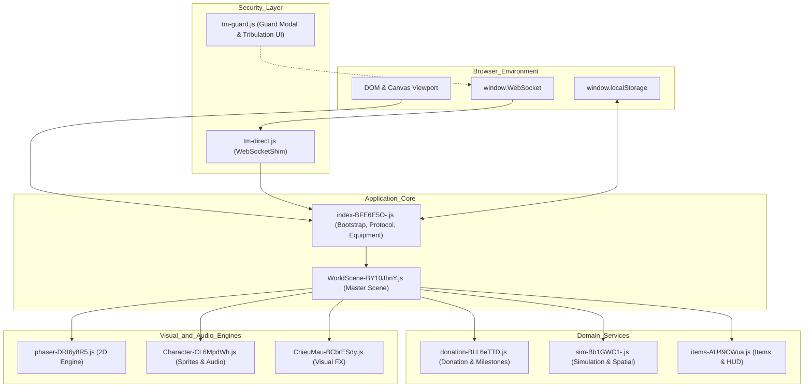

# GAME_ASSET_WIKI_v1.0 — Master Technical Reference

## 1. Project Overview & Scope

`GAME_ASSET_WIKI_v1.0` is the authoritative technical reference for the updated build of the browser-based JavaScript MMORPG client. 

This document synthesizes findings from ten independently analyzed JavaScript assets. It is designed to enable future software engineers and AI coding agents to inspect, trace, understand, and debug game systems with complete source verification and character-level accuracy.

**Core Principles:**
- **Zero Modification:** Original JavaScript files are preserved byte-for-byte in `source/`.
- **Traceability:** Every finding links to exact minified symbols, UTF-16 character offsets, and physical files.
- **Evidence Classification:** Facts are strictly classified as **CONFIRMED** (directly proven in source), **INFERRED** (logically deduced from architecture/data), **UNKNOWN** (insufficient evidence), or **CONFLICT** (discrepancies preserved).
- **Authoritative Boundary:** Distinguishes client-side visual interpolation and predictive simulation from server-authoritative state logic.

---

## 2. Asset Inventory & Source Verification

Ten JavaScript assets constitute the active client build in `source/`, representing 3,753,820 total bytes (~3.75 MB) of untouched minified code:

| Asset Name | Canonical Alias | Package / Provenance | Size (Bytes) | SHA-256 Hash | Primary Architecture Role |
|---|---|---|---|---|---|
| `Character-CL6MpdWh.js` | `Character-CL6MpdWh.js` | Current game asset snapshot | 69,325 | `24384560069ab9abcb95d49cf54b621795b626ec77e330e5954e1a26f4345b59` | Player animations, weapon FX, audio |
| `ChieuMau-BCbrESdy.js` | `ChieuMau-BCbrESdy.js` | Current game asset snapshot | 207,944 | `fa1c6a964bf931f4b0a0b976a4ee6416443eb5735ce0d69fada07e7d9db39b81` | Skill effect engine, sprite catalog |
| `WorldScene-BY10JbnY.js` | `WorldScene-BY10JbnY.js` | Current game asset snapshot | 1,061,908 | `9f0ed630e5fb8861e72b7bad33d6abc500fefb969d029a3609031beeda6f25e3` | Master Phaser scene, auto-farm, entities |
| `donation-BLL6eTTD.js` | `donation-BLL6eTTD.js` | Current game asset snapshot | 2,495 | `5434b4c8dec2bb47ee54e843a1d30eb51fc20e4cd65f7b9bd09841100e50351c` | Donation packages, top-up rewards, milestone tiers |
| `index-BFE6E5O-.js` | `index-BFE6E5O-.js` | Current game asset snapshot | 814,577 | `72914848af44332b105522bd77babf586b3db9ed8d54f14fcef2fc7a7207b0f9` | Bootstrap, network protocol, auth, equipment/gear registry |
| `items-AU49CWua.js` | `items-AU49CWua.js` | Current game asset snapshot | 18,338 | `167181dec3f7abf2b6db15b2879c930f2a1df82f7599a57fd83488c969e64ecd` | Item metadata, inventory UI, icons |
| `phaser-DRI6y8R5.js` | `phaser-DRI6y8R5.js` | `GAME_ASSET_WIKI_v1.0_phaser.zip` | 1,205,225 | `5920a4fd5e79aa7f0f3f87a914b4591ba68a8a87a0f6a5c3d49005a870a5d7b1` | Bundled Phaser 2D game engine |
| `sim-Bb1GWC1-.js` | `sim-Bb1GWC1-.js` | Current game asset snapshot | 363,360 | `c21abd27af331f05226cc6620fa86c9f5ad344030ab127db88d1208ac739ea46` | Combat simulation, spatial grid, quests |
| `tm-direct.js` | `tm-direct.js` | `GAME_ASSET_WIKI_v1.0_tm_direct_guard.zip` | 5,362 | `ac013042e8be620365ae650b48d4da80c40f0efa3ac9a2d061d74372f01a3965` | WebSocket connection shim |
| `tm-guard.js` | `tm-guard.js` | `GAME_ASSET_WIKI_v1.0_tm_direct_guard.zip` | 5,286 | `4a9ef0f8ae1a11556ba4f3ef386de7bc0c76cf0fa32b97d5309db4dff9dada47` | WebSocket message interceptor: displays anti-macro guard alertdialog and toggles mobile tribulation trigger |

*All extracted source files have been re-hashed and verified to match the active repository files with 100% byte fidelity.*

> [!IMPORTANT]
> **Active Snapshot vs. Historical Analysis Records:**
> The active source files in `source/` are the updated snapshot assets listed above.
> The historical detailed reports, per-module specifications in `modules/`, function maps, and `ASSET_INDEX.json` offsets were originally produced against earlier snapshot bundles (such as `WorldScene-b_2tpaKT.js`, `index-BIkbGDKp.js`, `sim-CvoxXTtu.js`, `trangbi-iyUH-plT.js`, `Character-DhQJ_Q0g(1).js`, and `items-nDkzNEls.js`).
> **All historical character offsets, line numbers, and minified local identifiers from the prior snapshot are `[UNVERIFIED]` against the current active assets.** In particular, equipment and stats scaling logic previously isolated in `trangbi-iyUH-plT.js` is now integrated into `index-BFE6E5O-.js`, and milestone donation rewards are defined in `donation-BLL6eTTD.js`. Developers and AI agents must locate symbols directly in the active source files.

---

## 3. System Architecture & Runtime Topology

The game client executes as a Single Page Application (SPA) inside modern web browsers:



---

## 4. Module Responsibilities & Boundaries

- **`WorldScene-BY10JbnY.js` (The Hub):** Responsible for managing scene state, ticking the auto-farm engine, rendering entity pools, and handling snapshot deltas.
- **`index-BFE6E5O-.js` (The Gateway & Codex):** Manages transport sockets, user session state, responsive viewport sizing, and equipment/gear registries (previously standalone `trangbi`).
- **`donation-BLL6eTTD.js` (The Benefactor):** Donation tiers, top-up reward packages, incense items, and milestone equipment rewards.
- **`sim-Bb1GWC1-.js` (The Predictor):** High-frequency spatial hash queries, collision geometry, and local combat damage prediction.
- **`Character-CL6MpdWh.js` (The Puppet):** Visual representation of human characters, directional movement frames, weapon sockets, and sound triggers.
- **`ChieuMau-BCbrESdy.js` (The Pyrotechnic):** Particle cascades, geometric slashes, beam emitters, and skill sound synchronization.
- **`items-AU49CWua.js` (The Merchant/Backpack):** Tooltips, icon coordinate lookups, and inventory keyboard bindings.
- **`tm-direct.js` & `tm-guard.js` (The Armor):** WebSocket connection proxy (`tm-direct.js`) and anti-macro guard alertdialog with mobile tribulation trigger (`tm-guard.js`).
- **`phaser-DRI6y8R5.js` (The Engine):** WebGL rendering, camera transformations, and audio playback.

---

## 5. Feature-to-Asset Routing Matrix

| Gameplay Feature | Primary Active Module | Historical Identifiers `[UNVERIFIED in current snapshot]` | Primary Dependencies | Limitations & Authoritative Boundary |
|---|---|---|---|---|
| **Auto-Farm Engine** | `WorldScene-BY10JbnY.js` | `A3.autoFarm`, `rk`, `sk`, `A3.castAutoSkill` | `sim`, `index` | Emits player commands; subject to server rate-limiting |
| **Pathfinding & Navigation** | `WorldScene-BY10JbnY.js` | `Tv.moveTo`, `ik`, `Wv` | `sim-Bb1GWC1-.js` | Client path planning; server verifies final coordinates |
| **Skill Particle FX** | `ChieuMau-BCbrESdy.js` | `io`, `Po`, `ye`, `sprite_assets` | `phaser`, `Character` | Visual-only; does not determine combat hit outcomes |
| **Character Direction & Mount** | `Character-CL6MpdWh.js` | `at`, `G`, `wt`, `ri`, `li`, `ui`, `vi` | `phaser-DRI6y8R5.js` | Purely visual representation on client |
| **Spiritual Root Advancement** | `sim-Bb1GWC1-.js` | `xm` (breakthrough table), `Dn` (root grades), `Hs = 30` (refining cost), `c1`, `d1` | Client cultivation state | Source confirms local configuration and calculations; authoritative server rules not established |
| **Equipment & Stat Scaling** | `index-BFE6E5O-.js` (formerly `trangbi`) | `ji`, `Cl`, `mt`, `Qu` | None (Leaf) | Canonical math tables integrated into index; server enforces caps |
| **Donation & Milestone Rewards** | `donation-BLL6eTTD.js` | `h` (tiers), `r` (Tụ Linh Hương), `v` (incense timer) | None (Leaf) | Local reward configuration; server validates payment and grants |
| **Inventory UI & Hotkeys** | `items-AU49CWua.js` | `M`, `Cn`, `Nn`, `N` | `index` | UI rendering; server validates item ownership |
| **WebSocket Networking** | `index-BFE6E5O-.js` | `ey` (driver), `receive` (message handling), `snapshots.decode` (`snap2` decoding) | Browser WebSocket / RTC channel | Client transport and snapshot handling are visible; remote protocol authority remains unknown |
| **Socket Interception** | `tm-direct.js` | `WebSocketShim`, `production` | Browser Globals | Client-side connection proxy |
| **Anti-Macro Challenge & Mobile Tribulation** | `tm-guard.js` | `feed`, `show`, `tribButton` | WebSocket Streams | Server-authoritative challenges; local DOM presentation |
| **Fishing Minigame** | `WorldScene-BY10JbnY.js` / `sim-Bb1GWC1-.js` | `tv` (scene-side fishing UI), `my` (sim-side fishing system) | Client scene / simulation | Scene presents fishing phases from incoming state; authoritative online catch rewards not established |

**Source-identity note:** Historical symbol names and offsets listed above are preserved for navigation and historical cross-referencing. Because active asset hashes changed, developers must locate symbols directly in the active source files. In current `index-BFE6E5O-.js`, the driver class is minified as `ey` and snapshots are decoded by `Zp`.

---

## 6. Gameplay Systems

### Character & Player Management
Player entities (`ok`) support 8-directional rendering, mount riding, meditation postures, and fishing stances. Equipment appearance updates dynamically by changing texture keys on weapon, body, and head sub-sprites.

### Combat & Skills
Skills are categorized into Physical (Kiếm, Đao, Qung, Quyền) and Magical (Pháp, Trận). Each skill has:
- A cooldown timer managed in `WorldScene`.
- A mana cost verified against player current resources.
- A visual manifestation executed by `ChieuMau`.
- A predictive damage calculation evaluated by `sim`.
- A server command dispatched via `index`.

### Automation (Auto-Farm)
The auto-farm system provides fully automated gameplay:
1. **Target Search:** Queries `sim` spatial grid for the nearest valid monster within 800px.
2. **Navigation:** Calls `Tv` A* pathfinder to navigate within attack range.
3. **Skill Selection:** Evaluates available non-cooldown skills and casts the highest priority spell.
4. **Potion Health Management:** Monitors HP/MP against user threshold percentages and triggers quick-use belt items.
5. **Auto Loot:** Detects nearby drop entities (`ew`) and collects them before picking new monster targets.
6. **Death Recovery:** Monitors player death state and triggers respawn after delay.

---

## 7. Important Formulas and Constants

### Level Scaling Curve (`ji` in `trangbi-iyUH-plT.js`)
```javascript
ji = {
  levels: [18, 60, 122, 198, 278, 364, 454, 544, 634, 724, 814, 904, 976],
  hp:     [1.561, 0.638, 0.375, 0.394, 0.452, 0.537, 0.667, 0.838, 1.056, 1.287, 1.632, 2.085, 2.706],
  hit:    [0.533, 0.220, 0.142, 0.139, 0.161, 0.175, 0.209, 0.268, 0.334, 0.388, 0.494, 0.652, 0.896]
};
```
The scaling table represents non-linear attribute exponents across 13 progression tiers. HP exponents scale sharply above level 634 (reaching 2.706 at level 976) to counteract endgame weapon stat compounding.

### Armor Defense Formula (`sim-CvoxXTtu.js`)
`DamageReduction = Armor / (Armor + 100 * AttackerLevel)`

### Critical Damage
`CriticalMultiplier = 1.5 + (CritDamageBonus / 100)`

---

## 8. Guide for Future AI Agents & Developers

When assigned tasks on this game client:
1. **Never edit the original bundles in `source/` directly.** Treat them as reference data.
2. **Consult [ASSET_INDEX.json](ASSET_INDEX.json)** to find exact function locations and minified names using 0-based UTF-16 offsets.
3. **When implementing automation features or bots:** Study the `WorldScene-b_2tpaKT.js` auto-farm state machine documented in [CROSS_MODULE_ANALYSIS.md](CROSS_MODULE_ANALYSIS.md).
4. **When modifying UI or tooltips:** Reference `items-nDkzNEls.js` for key bindings and slot structures.
5. **When adding custom visual effects:** Reference `ChieuMau-CEtRLp-4.js` sprite catalog records in [modules/02_ChieuMau-CEtRLp-4.md](modules/02_ChieuMau-CEtRLp-4.md).

---

## 9. Source Verification Methodology

- All source files have zero-based UTF-16 code unit offsets documented.
- Module boundaries match ECMAScript standard import/export semantics.
- Integrity is backed by SHA-256 cryptographic hashes verified in [SOURCE_MANIFEST.json](SOURCE_MANIFEST.json).


## Restored original analysis evidence

The unified [ASSET_INDEX.json](ASSET_INDEX.json) now has **16,037 mixed-type lookup entries**. For complete raw metadata, per-module original function/dependency maps, or original source positions, navigate via [original_indexes/INDEX_REGISTRY.json](original_indexes/INDEX_REGISTRY.json) and [references/ORIGINAL_SYMBOL_LOOKUP.json](references/ORIGINAL_SYMBOL_LOOKUP.json). These original analysis records are preserved, **not automatically semantically verified**. Phaser original positions are code points; unified positions are UTF-16. Source anchors are not entire function ranges. See [RESTORATION_REPORT.md](RESTORATION_REPORT.md).
